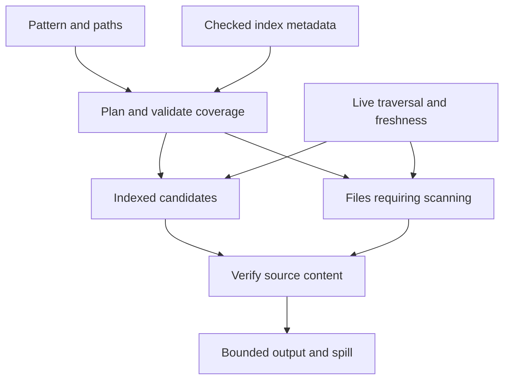

# tgrep architecture

## Correctness boundary and ownership

tgrep owns segments, manifest, freshness metadata, planning and live traversal.
Selected KEYSTONE sources extract/intersect trigrams; selected QIHSE sources
provide WAL/persistence helpers. Rust's `ignore` and ripgrep matching/output
crates perform traversal and content verification. Root `build.rs` enumerates
linked native files; entire vendor trees are not linked.

Ordinary queries walk requested paths, compare full file identity/freshness,
prune only unchanged files covered by checked current-format segments, and
verify candidates. New, changed, unindexed, oversized and BOM-marked UTF-16
sources are scanned. Cached filenames only reorder work. Concurrent source
changes retain normal live-search race semantics.

| Source | Responsibility |
| --- | --- |
| `src/main.rs`, `src/rg_compat.rs` | Direct CLI and conservative wrapper delegation. |
| `src/search.rs` | Planning, traversal, identity memo, pruning, verification, output/cancellation. |
| `src/build.rs` | Ingestion, resource accounting, writer lock, publication/recovery. |
| `src/build/compaction.rs` | Checked snapshot merge, ID remapping and publication. |
| `src/store.rs` | TGS reader/writer and manifest integrity. |
| `src/index.rs` | Administrative dispatch, full validation and disk accounting. |
| `src/native.rs`, `native/` | Rust ownership wrappers and narrow native interfaces. |
| `src/cache_v2.rs` | Generation-bound query ordering hints. |
| `vendor/QIHSE/src/tractable/qihse_wal.c` | Framed WAL validation, replay/checkpointing. |

State contains a manifest, build history, immutable segments, staging, WAL,
writer lock and optional pause/cache data. No fixed workstation or ZFS dataset
is required. State resolution is documented in the README.

## Checked compact formats

**TGS v2** retains `TGS1` magic with explicit version 2 and a 74-byte header. Its
document/path tables, sorted trigram dictionary, block-compressed delta-varint
postings and footer replace the redundant v1 duplicate block table. Metadata CRC
covers header through dictionary before negative pruning. Each posting-block CRC
covers its maximum ID, encoded length and payload.

`open_for_search` checks metadata; `try_read_postings` checks accessed blocks and
returns corruption errors. Administrative `open` checks every posting.
`visit_postings` supplies checked compaction traversal; `document_frequency`
reads checked dictionary counts without decoding postings. V1 remains available
for administrative inspection but cannot authorize pruning because earlier
builders indexed raw UTF-16 bytes while the verifier decoded the text.

Exact TGS bytes are `90 + 64D + 2L + 16G + 12B + V`, where D is documents,
L raw path bytes counted once, G dictionary keys, B posting blocks, and V varint
bytes.

**QWI v3** has a 56-byte header, 24-byte directory record per block of at most
512 entries, and 12-byte entries (64-bit hash, 32-bit document ID). Generation
and TGS metadata fingerprint bind the sidecar. Header/directory integrity is
checked before negative lookup. Every overlapping payload block is checked,
including equal-hash runs spanning blocks. FFI errors remain errors rather than
empty candidates. Hash collisions broaden candidates and are resolved by source
verification. Exact size is `56 + 24*ceil(W/512) + 12W` bytes for W entries.

Missing QWI falls back to checked trigrams or verifies all otherwise-covered
files for a token without trigrams. Legacy unchecked QWI/THI cannot establish
absence. Sidecar saves stage, sync, atomically rename and sync the directory.
CRC32 detects corruption/mixed restores; it does not authenticate against an
actor who can rewrite state and recompute checksums.

Readonly mmap assumes immutable published files: replacements use staged new
inodes, and old files are unlinked rather than truncated in place.

## Build and publication

A writer lock covers build, recovery or compaction. Discovery obeys ignore rules
and canonical state exclusion. Ingestion is serial after bounded parallel
discovery. Word deduplication borrows token slices; duplicate THI construction
is removed. Oversized/BOM UTF-16 sources stay scan-only; binary word entries
remain available for verifier parity.

Paths retain exact bytes and bound root IDs. QWI binds the just-written TGS.
Completed builds atomically replace the manifest. Budget failures preserve the
previous manifest. Conservative reservations, RSS samples and I/O pacing are
cooperative; they do not impose hard process or filesystem limits.

## WAL v2

The 32-byte segment header contains an invalid-legacy zero sentinel, versioned
magic, version, segment index and CRC32. Index must match the strict
`wal_%020index.log` filename. V2 integers are little-endian. The 34-byte record
header stores LSN, transaction, engine, operation, lengths, payload CRC and an
independent header CRC. Lengths cannot authorize EOF repair before validation.

Complete corruption fails unchanged. Only an incomplete final v2 record in the
last segment is repairable. Complete legacy records remain readable; incomplete
legacy tails fail because their lengths lack independent integrity. Appending
creates a new v2 segment. New headers are staged/synced before no-replacement
publication. The repaired 1.1 reader rejects the zero sentinel; pre-repair readers
may silently stop replay or append to unsupported data. V2 state must not be used
with older binaries. A downgrade requires a separate pre-migration state.

Validation precedes callbacks and cleanup. Allocation resumes above stored and
checkpointed LSNs. Short writes/EINTR are handled; write or required sync failures
poison the handle. Durable checkpoint high-water publication precedes pruning.

## Snapshot compaction

Compaction does not read source files. It preserves roots, raw paths and
freshness metadata, remaps sparse IDs into a dense output, merges checked
postings, and imports verified QWI blocks. Missing QWI omits combined QWI;
present inputs must still validate. Ambiguous roots and legacy provenance fail.

Inputs validate before the output transaction: BEGIN, staged TGS/QWI, segment
record, COMMIT, manifest publication, then checkpoint/obsolete cleanup. After
any commit attempt, files are retained on error because a failed sync may leave
a complete COMMIT. Ambiguous publication retains both snapshots. Old mmaps
survive unlink after confirmed replacement. `build.json` remains source-build
history; manifest generation changes. Zero/one segment is a no-op/checked no-op.

## Query overhead and bounded output

Streaming avoids segment opening and cache work. Indexed plans memoize canonical
identities and aggregate source bytes during existing root-binding validation.
A cost policy chooses streaming for at least 128 documents, average size at most
64 KiB, and a candidate upper bound of at least half the documents. The bound is
the minimum necessary-trigram document frequency per segment, summed across
segments. It is an estimate, not a match count or correctness assumption.

Workers are capped at 64; the completed-file queue is twice the worker count.
Each file buffers at most 1 MiB before private anonymous spooling. Linux
`O_TMPFILE` is preferred; fallback mode-0600 files are unlinked before writing.
Chunked copying propagates write/flush failures. Failed files withhold their
buffered prefix; consumer failure cancels and drops the receiver, releasing
blocked producers. The cap covers output buffering, not total RSS/matcher memory.

Unused optimizer recommendations, duplicate signature decoding and synthetic
speedup writes are removed from queries. Remaining native interfaces are tested
and inventoried. Deployment performance requires measurement; old cache-trust
ratios do not describe this live-file contract.
